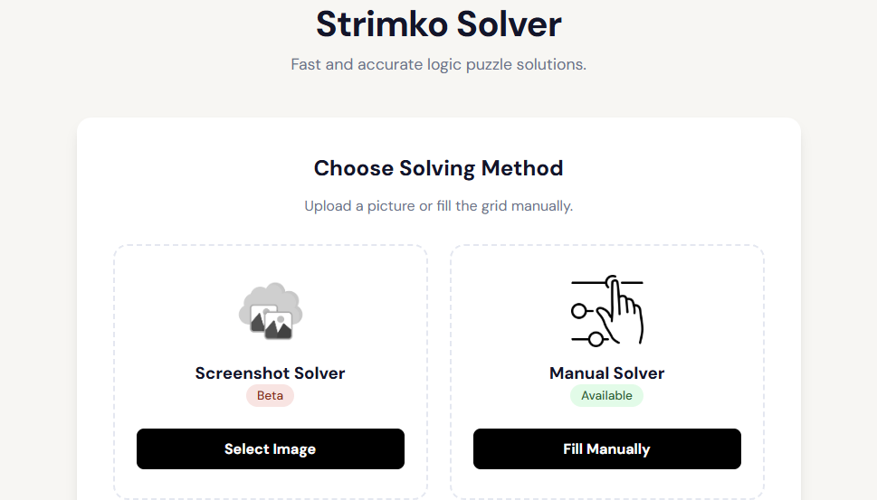

# Strimko Solver

A free online solver for Strimko puzzles. Upload a screenshot or enter numbers and connect streams manually, then solve the grid in your browser.

**[Try it online](https://lomkaka1ff.github.io/Strimko-Solver/)** · **[Report a bug](https://github.com/LomkaKa1ff/Strimko-Solver/issues)**

## Preview

## Features

- Solve puzzles from screenshots or enter them manually.
- Detect connecting lines directly from the uploaded image.
- Recognize printed numbers using AI.
- Support branching streams and closed loops.
- Edit numbers and connections before solving.
- Use the manual solver without an API key.

## How to use

### From a screenshot

1. Click **Select Image** and upload a puzzle.
2. Check the recognized numbers and connections.
3. Click **Solve**.

For best results, crop the image to the puzzle and keep all circles visible.

### Manually

1. Click **Fill Manually**.
2. Click a circle to enter a number.
3. Use **Shift + Click** to connect circles.
4. Click **Solve**.

## Built with

- HTML, CSS and JavaScript
- Canvas API for grid rendering and line detection
- Node.js and Express
- OpenRouter for screenshot digit recognition

## Feedback

Found a bug or have an idea?
[Open an issue](https://github.com/LomkaKa1ff/Strimko-Solver/issues).

GitHub Issues are public. Never include API keys or personal information.

## Donate

If you find this project useful, you can
[buy me a coffee](https://buymeacoffee.com/strimkosolver).

## License

This project is licensed under the [MIT License](LICENSE).
